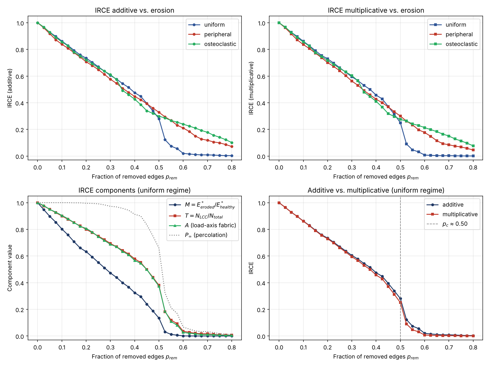

# RA-Trabecular

**A Percolation-Based Framework for Modeling Trabecular Bone Degradation in Rheumatoid Arthritis Using Voronoi Tessellation and Effective Mechanical Connectivity**

[](https://opensource.org/licenses/Apache-2.0)
[](https://www.python.org/downloads/)
[](https://doi.org/10.5281/zenodo.20467022)

[](https://orcid.org/0009-0006-2030-1849)

DOI: https://doi.org/10.5281/zenodo.20467022

> **Status:** Concept paper + initial implementation (v0.1.1, work in progress)
> **Author:** Verónica Zumpano Blumenfeld
> **ORCID:** [0009-0006-2030-1849](https://orcid.org/0009-0006-2030-1849)

---

## Overview

**RA-Trabecular** is an open-source computational framework that reformulates trabecular bone degradation in rheumatoid arthritis (RA) as a **percolation transition over a Voronoi-tessellated network**, rather than as a gradual reduction in bone mineral density.

The framework introduces the **Index of Effective Mechanical Connectivity (IRCE)**, a dimensionless composite metric that integrates:

- **Normalized effective elastic modulus** (from finite element analysis)
- **Topological connectivity** of the load-bearing subnetwork
- **Local anisotropy** of trabecular architecture

The central hypothesis is that RA-driven erosion produces a **critical structural transition** at which the trabecular network fragments mechanically — a regime invisible to standard density-based metrics.

## Why this matters

Current clinical assessment of RA-related bone loss relies on morphological descriptors (erosion volume, BMD, semi-quantitative scoring) that **systematically miss the topological event that determines failure**: loss of structural connectivity.

By treating trabecular degradation as a critical phenomenon, RA-Trabecular aims to identify patients approaching mechanical failure **before** erosion becomes radiographically conspicuous.

## Framework architecture

```
                ┌─────────────────────┐
                │  Voronoi Generation │
                │  (3D seed-based)    │
                └──────────┬──────────┘
                           │
                ┌──────────▼──────────┐
                │ Progressive Erosion │
                │ (edge removal)      │
                └──────────┬──────────┘
                           │
              ┌────────────┼────────────┐
              │            │            │
       ┌──────▼──────┐ ┌───▼────┐ ┌────▼─────┐
       │ FEM (E_eff) │ │ Graph  │ │Anisotropy│
       │             │ │ (LCC)  │ │  (MIL)   │
       └──────┬──────┘ └───┬────┘ └────┬─────┘
              └────────────┼────────────┘
                           │
                ┌──────────▼──────────┐
                │       IRCE          │
                │  + critical point   │
                └─────────────────────┘
```

## Key concept: the IRCE

```
IRCE = α·M + β·T + γ·A

M = E*_eroded / E*_healthy          (effective modulus ratio)
T = N_LCC / N_total                 (connectivity of the load-bearing subnetwork)
A = load-axis fabric retained       (anisotropy component, A = 1 when healthy)
```

with α + β + γ = 1 (defaults 0.4 / 0.4 / 0.2) and IRCE ∈ [0, 1]. All three components are normalized against the healthy reference network. See [`docs/irce_definition.md`](docs/irce_definition.md) for the formal definition.

- **IRCE = 1** → pristine, fully load-bearing network
- **IRCE → 0** → fragmented, mechanically incompetent structure
- **IRCE_c** → hypothesized critical threshold (universal within a topology class)

A multiplicative (synergistic) formulation is also implemented as an alternative:

```
IRCE_mult = M^α · T^β · A^γ
```

## Repository structure

```
ra-trabecular/
├── README.md                  # This file
├── LICENSE                    # Apache 2.0
├── CITATION.cff               # Machine-readable citation
├── CHANGELOG.md               # Version history
├── CONTRIBUTING.md            # Contribution guidelines
├── requirements.txt           # Python dependencies
├── pyproject.toml             # Package configuration
├── docs/
│   ├── theory.md              # Theoretical foundation
│   ├── irce_definition.md     # Formal IRCE specification
│   └── roadmap.md             # Development plan
├── src/ra_trabecular/
│   ├── __init__.py
│   ├── voronoi.py             # Network generation
│   ├── erosion.py             # Progressive erosion models
│   ├── mechanics.py           # FEM and effective modulus
│   ├── connectivity.py        # Graph-theoretic metrics
│   ├── anisotropy.py          # MIL and anisotropy tensor
│   └── irce.py                # IRCE computation
├── notebooks/
│   └── 01_voronoi_basic.ipynb # First reproducible example (generates figures/01_irce_trajectory.png)
├── tests/
│   └── test_irce.py
├── data/                      # Datasets (or pointers to public ones)
└── figures/                   # Reproducible outputs
```

## Quick start

```bash
# Clone the repository
git clone https://github.com/Vlattice/ra-trabecular.git
cd ra-trabecular

# Install (add [all] for notebooks and tests)
pip install -e ".[all]"

# Run the tests
pytest

# Run the first example notebook
jupyter notebook notebooks/01_voronoi_basic.ipynb
```

## Minimal example

```python
from ra_trabecular import (
    generate_voronoi_network, progressive_erosion, ErosionRegime, compute_irce,
)

# 1. Generate a 3D Voronoi trabecular network (the healthy reference)
healthy = generate_voronoi_network(n_seeds=200, domain_size=10.0, rng_seed=42)

# 2. Simulate progressive erosion (default: up to 80 % of struts removed)
trajectory = progressive_erosion(
    healthy, n_steps=20, regime=ErosionRegime.UNIFORM, rng_seed=42
)

# 3. Compute IRCE along the trajectory (each state vs. the healthy network)
for state in trajectory:
    r = compute_irce(state.network, healthy)
    print(f"p = {state.p_removed:.2f}  IRCE = {r.irce:.3f}  "
          f"(M = {r.modulus_ratio:.2f}, T = {r.connectivity_ratio:.2f}, A = {r.anisotropy:.2f})")
```

The healthy network gives IRCE = 1. Under uniform erosion the IRCE falls sharply between ≈ 45 % and 55 % of struts removed — the percolation transition the framework is designed to detect.



## Potential applications

Beyond rheumatoid arthritis, the framework may apply to osteoporosis, psoriatic arthritis, subchondral osteoarthritis and, more generally, to structural-failure prediction in computational bone biomechanics.

## Citation

If you use RA-Trabecular in academic work, please cite:

> Zumpano Blumenfeld, V. (2026). *RA-Trabecular: A Percolation-Based Framework for Modeling Trabecular Bone Degradation in Rheumatoid Arthritis Using Voronoi Tessellation and Effective Mechanical Connectivity* [Software]. Zenodo. https://doi.org/10.5281/zenodo.20467022

Or use the machine-readable `CITATION.cff` file (GitHub will render a "Cite this repository" button automatically).

## Roadmap

- [x] **v0.1.0** — Concept paper, Voronoi generation, three erosion regimes, connectivity metrics, IRCE (additive and multiplicative)
- [x] **v0.1.1** — IRCE normalization and modulus fixes, executable notebook (see [CHANGELOG](CHANGELOG.md))
- [ ] **v0.2.0** — Direction-selective erosion, fabric-tensor anisotropy, weight sensitivity analysis
- [ ] **v0.3.0** — FEM integration (beam/truss formulation)
- [ ] **v0.4.0** — Validation against public micro-CT datasets
- [ ] **v0.5.0** — Clinical-scale (HR-pQCT) extension
- [ ] **v1.0.0** — Short Communication submission to *Bone* / *Journal of Biomechanics*

## License

This project is licensed under the **Apache License 2.0** — see [LICENSE](LICENSE) for details.

Apache 2.0 was chosen over MIT because it includes an explicit patent grant clause, providing stronger protection against patent litigation for both authors and users.

## Contributing

Contributions are welcome. See [CONTRIBUTING.md](CONTRIBUTING.md) for guidelines.

## Contact

**Verónica Zumpano Blumenfeld**
ORCID: [0009-0006-2030-1849](https://orcid.org/0009-0006-2030-1849)

---

*This work follows open science principles. Each release is archived with a persistent DOI through Zenodo, ensuring long-term reproducibility and citability.*
